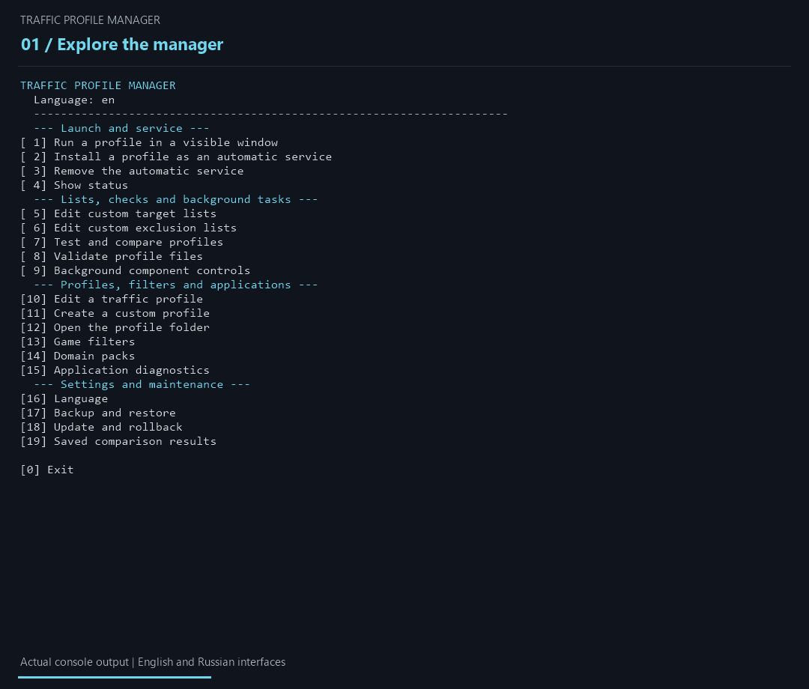

<div align="center">

<h1>Traffic Profile Manager</h1>

<p><strong>Подберите и настройте профиль zapret2 под своё подключение.</strong></p>

<p>
  
  <a href="https://github.com/ArcheKaren/Traffic-Profile-Manager/releases/latest"></a>
  <a href="https://github.com/ArcheKaren/Traffic-Profile-Manager/actions/workflows/validate.yml"></a>
  
  
  
  
</p>

<p>
  <a href="https://github.com/ArcheKaren/Traffic-Profile-Manager/releases/latest/download/TrafficProfileManager.zip"></a>
</p>

<p>
  <a href="https://github.com/ArcheKaren/Traffic-Profile-Manager/releases/latest">Что нового</a> ·
  <a href="docs/VERIFY.md">Проверить сборку</a>
</p>

<p><strong>Русский</strong> · <a href="docs/README.en.md">English</a></p>

<p>
  <a href="#demo">Демонстрация</a> ·
  <a href="#quick-start">Быстрый запуск</a> ·
  <a href="#profiles">Профили</a> ·
  <a href="#comparison">Сравнение</a> ·
  <a href="#customization">Настройка</a> ·
  <a href="#diagnostics">Диагностика</a> ·
  <a href="#build">Сборка</a> ·
  <a href="#license">Лицензия</a>
</p>

</div>

---

Traffic Profile Manager — переносимый консольный менеджер zapret2 для Windows:
14 готовых профилей, автоматическое сравнение на вашем подключении, игровые
фильтры и управление службой. Без VPN и телеметрии.

Проверьте несколько стратегий на нужных вам адресах, сравните результаты
и выберите подходящий профиль. Настройте отдельные домены, IP и исключения;
запускайте профиль в видимом окне или установите его как автоматическую службу.
Сравнение показывает доступность проверенных адресов в момент запуска —
результат зависит от подключения и выбранного списка целей.

<a id="demo"></a>

## 🎬 Как выглядит работа



25 секунд вывода настоящей программы: главное меню, выбор профиля, проверка
параметров и просмотр сохранённого сравнения. Показанный рейтинг получен
28 июля 2026 года; это пример отчёта, а не обещание результата на другом
подключении. [Происхождение демонстрации](docs/media/README.md).

<a id="features"></a>

## ✨ Возможности

- переносимая сборка без установщика;
- 14 готовых профилей с разными комбинациями обработки TLS, HTTP, QUIC,
  Discord и медиатрафика;
- отдельный BAT-файл для каждого готового профиля;
- автоматическое обнаружение изменённых и пользовательских JSON-профилей;
- видимый режим, который завершается вместе со своим окном;
- необязательная автоматическая служба Windows;
- отдельно управляемая задача обновления сопоставлений, по умолчанию
  выключенная;
- пользовательские списки доменов, IP/CIDR и исключений;
- тематические пакеты доменов с отдельной ревизией каталога и совместимым
  итоговым `domains.txt`;
- автоматически обнаруживаемые пользовательские пакеты, сохраняемые отдельно
  от комплектного каталога;
- отдельные игровые фильтры с пользовательскими `hosts`, доменами, IP и
  исключениями;
- независимый универсальный игровой TCP/UDP-транспорт для выбранных портов;
- сравнение профилей с контрольным замером, повторной проверкой лидеров,
  отчётами TXT/CSV и просмотром сохранённых результатов;
- именованные наборы настроек в JSON/TXT и прямой запуск набора через BAT;
- пошаговый конструктор JSON-профиля с проверкой через `winws2 --dry-run`;
- контроль неприменённых настроек и применение конфигурации к службе с откатом;
- локальная диагностика приложений с отчётами TXT и JSON;
- проверка JSON и реальная валидация параметров через `winws2 --dry-run`;
- английский и русский интерфейс, цветные состояния и локальные подсказки;
- резервные копии настроек, проверяемые обновления и откат файловых операций;
- защищённая очистка процессов, состояния и управляемых записей `hosts`.

<a id="requirements"></a>

## 🖥️ Системные требования

| Компонент | Требование |
| --- | --- |
| Операционная система | 64-разрядная Windows 10 или Windows 11 |
| Права | Локальный администратор |
| Командная оболочка | Windows PowerShell 5.1 или новее |
| HTTP-клиент | Системный `curl.exe` |
| Runtime | `winws2`, WinDivert, Cygwin runtime и Lua-файлы zapret2 |

В готовом ZIP уже есть все необходимые runtime-файлы. В Git-репозитории
сторонние бинарники не хранятся — см. раздел
[Сборка из исходников](#сборка-из-исходников).

<a id="verify"></a>

## 🔐 Права администратора и проверка сборки

WinDivert перехватывает и изменяет сетевые пакеты, поэтому для работы профиля
нужны права администратора. `Manager.bat` запрашивает их при открытии;
просмотр профилей, диагностика и `winws2 --dry-run` через CLI могут выполняться
без повышения прав. Служба устанавливается по выбранному пользователем действию,
а временные сопоставления затрагивают только управляемый блок Windows `hosts`.

Скачивайте ZIP и `SHA256SUMS.txt` из одного официального релиза и проверяйте
SHA-256 перед запуском. WinDivert может вызывать предупреждения антивирусов;
совпадение хеша подтверждает целостность файла, но не гарантирует его безопасность.

[Пошаговая проверка и пояснения](docs/VERIFY.md) ·
[Исходники](https://github.com/ArcheKaren/Traffic-Profile-Manager) ·
[Проверки и сборка CI](https://github.com/ArcheKaren/Traffic-Profile-Manager/actions) ·
[Сторонние компоненты](docs/THIRD-PARTY-LICENSES.txt)

<a id="quick-start"></a>

## 🚀 Быстрый запуск

1. Скачайте `TrafficProfileManager.zip` из
   [последнего релиза GitHub](../../releases/latest).
2. Полностью распакуйте каталог `TrafficProfileManager`. Не запускайте файлы
   непосредственно из ZIP.
3. Запустите `Manager.bat` и подтвердите запрос UAC.
4. Выберите **Run a profile in a visible window**.
5. Для начала попробуйте **Base**.
6. Пока окно профиля открыто, профиль работает.
7. Закройте окно или нажмите `Ctrl+C`, чтобы остановить профиль и удалить его
   временные сопоставления.

Не запускайте два профиля одновременно. Если установлена автоматическая служба,
остановите или удалите её перед использованием видимого режима.

<a id="manager"></a>


## 🧭 Пункты менеджера

| Пункт | Действие | Постоянное изменение системы |
| --- | --- | --- |
| Run a profile | Запускает выбранный профиль в видимом окне | Нет |
| Install as service | Создаёт и запускает `TrafficProfileService` | Да |
| Remove service | Останавливает и удаляет службу и связанную задачу | Удаляет изменения |
| Show status | Показывает состояние службы, задачи, процессов и сопоставлений | Нет |
| Edit target lists | Открывает пользовательские списки доменов или IP | Изменяет локальные файлы |
| Edit exclusion lists | Открывает пользовательские списки исключений | Изменяет локальные файлы |
| Test and compare | Проверяет все обнаруженные корректные профили | После очистки — нет |
| Validate profiles | Запускает `winws2 --dry-run` для каждого профиля | Нет |
| Background controls | Управляет службой, задачей и сопоставлениями | Зависит от действия |
| Edit profile | Открывает готовый или пользовательский JSON-профиль | Изменяет локальный файл |
| Create profile | Копирует существующий профиль под новым ID | Создаёт локальный файл |
| Open profile folder | Открывает `config\profiles` в Проводнике | Нет |
| Game filters | Управляет переносимыми игровыми наборами | Изменяет локальное состояние и файлы выбранного набора |
| Domain packs | Создаёт и переключает комплектные или пользовательские пакеты | Изменяет локальное состояние и готовый список |
| Application diagnostics | Проверяет выбранную группу адресов и создаёт локальные отчёты | Создаёт файлы в `test-results` |
| Language | Выбирает English или Русский | Сохраняет локальную настройку |
| Backup and restore | Создаёт копию настроек или восстанавливает её после просмотра списка файлов | Изменяет локальные файлы по подтверждению |
| Update and rollback | Проверяет обновления, устанавливает проверенный архив или откатывает операцию | Изменяет файлы программы по подтверждению |
| Saved comparison results | Показывает прошлые результаты и позволяет выбрать профиль | Выбор применяется после перезапуска профиля |
| Named setups and application | Сохраняет и переключает наборы, показывает неприменённые изменения | Изменяет настройки; применение к службе — отдельное действие |

Именованные наборы доступны в пункте 20, пошаговый конструктор — внутри
**Create a custom profile**. Настройки остаются редактируемыми JSON/TXT;
прежние BAT-профили и CLI сохранены.
[Наборы, конструктор, применение и режимы сравнения](docs/SETUPS.md).

Основной язык интерфейса — английский. В **Manager → Language** можно выбрать
**English** или **Русский**; выбор сохраняется в `state/user-settings.json`.
Команды, ID профилей и поля JSON
остаются английскими; исходные сообщения Windows и `winws2` сохраняют свой язык.
Основная документация ведётся на русском; [краткое руководство доступно на английском](docs/README.en.md).

Резервная копия сохраняет `config`, `lists`, `assets`, пользовательские
настройки из `state` и пул проверки `tests/targets.txt`. Runtime, журналы,
PID-файлы и системный `hosts` в неё не входят. Перед восстановлением менеджер
показывает файлы, которые будут заменены; для применения нужно ввести `RESTORE`.
В разделе восстановления выберите номер готовой копии из `backups` или вставьте
путь к существующему ZIP. Путь можно вставить в кавычках; пустой ввод или `0`
отменяет выбор. Если копий ещё нет, сначала создайте их через **Create a backup**.

Обновление проверяет SHA-256 и структуру архива, создаёт копию настроек и
сохраняет существующие файлы `config`, `lists` и `assets`. Перед применением
показываются замены, сохраняемые файлы и удаления. Для установки введите `UPDATE`.
Работающие профили нужно остановить. При установленной службе сначала
сохраните настройки и удалите службу, затем обновите программу и установите
её заново: служба использует отдельную защищённую копию файлов.

Для отката укажите ID операции из результата установки или восстановления.
Снимки прежних файлов хранятся в `backups/transactions`. Откат не перезаписывает
файлы, изменённые после операции: в этом случае он остановится с объяснением.
Проверка обновлений и загрузка выполняются только по выбранному действию.
Старые архивы без метаданных сборки не устанавливаются новым механизмом.

<a id="profiles"></a>

## 🧩 Готовые профили

Номер определяет порядок в меню и имя комплектного BAT-файла. Больший номер не
означает, что профиль лучше.

| № | Профиль | Основное отличие |
| ---: | --- | --- |
| 1 | Base | Осторожная общая обработка и отдельные правила Discord/WhatsApp |
| 2 | Base (Split position 1) | Простой разрез общего TLS в позиции 1 |
| 3 | Base (Fake TLS with MD5) | Поддельный TLS, MD5 и сдвиг последовательности |
| 4 | Base (Automatic TTL) | Автоматический TTL для fake-пакета и fake split |
| 5 | Base (QUIC fake) | Поддельный QUIC вместо удаления QUIC-пакетов |
| 6 | Base (Multiple split positions) | Несколько позиций TLS disorder |
| 7 | Base (Randomized TLS) | Рандомизированный fake TLS и дублированный session ID |
| 8 | Base (Sequence overlap) | Изменение TCP timestamp и перекрытие последовательности |
| 9 | Base (Current defaults) | Текущие zapret2-подобные настройки для общих и отдельных правил |
| 10 | Base (Full fake TLS with MD5) | Fake TLS/MD5 во всех основных группах правил |
| 11 | Base (Full automatic TTL) | Auto-TTL для HTTP, TLS и отдельных групп |
| 12 | Base (Full multiple positions) | Несколько позиций split/disorder в группах правил |
| 13 | Base (Timestamp overlap) | Timestamp и overlap в общих и отдельных правилах |
| 14 | Base (Mixed aggressive) | Более интенсивное сочетание fake, disorder, auto-TTL и QUIC |

Сетевые маршруты отличаются. Для выбора профиля на конкретном компьютере
используйте общее сравнение и обязательно проверяйте реальные приложения.

<a id="direct-run"></a>

## ▶️ Прямой запуск

Каждый готовый профиль можно запустить без менеджера:

```text
1 - Base.bat
2 - Base (Split position 1).bat
...
14 - Base (Mixed aggressive).bat
```

Любой обнаруженный пользовательский профиль запускается из менеджера или из
терминала администратора:

```bat
tools\run-profile.bat my-profile-id
```

Видимый режим владеет только запущенным им процессом. Контроллер и сторож
используют сохранённые PID, поэтому закрытие окна останавливает соответствующий
`winws2`, после чего удаляет управляемый блок сопоставлений.

Прямые BAT-файлы используют тот же порядок запуска и очистки. Временные
сопоставления принадлежат сеансу профиля; при штатном завершении контроллер
дожидается скрытого процесса очистки.
При переходе между разделами менеджер очищает экран. Успешные состояния
показываются зелёным, ошибки — красным, предупреждения — оранжевым. Если
консоль не поддерживает расширенные цвета, для предупреждений используется
тёмно-жёлтый цвет.

Окно профиля показывает одну сводку: имя, состояние, подсказку остановки и
пути к журналам. Технический stdout/stderr сохраняется в отдельные файлы
`logs/foreground-*.stdout.log` и `logs/foreground-*.stderr.log`. При ошибке
запуска последние строки выводятся красным; команда `zapretctl logs` выбирает
самый свежий непустой журнал runtime.

<a id="comparison"></a>

## 🧪 Сравнение профилей

Запустите `tools\Test Profiles.bat` или соответствующий пункт менеджера. Для каждого
корректного JSON-профиля тест:

1. запускает профиль;
2. ждёт готовности runtime и временных сопоставлений;
3. параллельно проверяет все URL из `tests\targets.txt`;
4. записывает HTTP-результат и диагностические сведения;
5. останавливает профиль и очищает временное состояние;
6. сортирует профили по числу доступных конечных точек.

Отчёты сохраняются в `test-results`:

- `profile-comparison-YYYYMMDD-HHMMSS.txt` — сводка и рейтинг;
- `profile-comparison-YYYYMMDD-HHMMSS.csv` — подробные результаты по адресам.

### 📊 Обозначения результатов

| Метка | Значение |
| --- | --- |
| `OK` | Получен HTTP 2xx, 3xx или 4xx |
| `UP` | Сервер доступен, но вернул HTTP 5xx |
| `--` | HTTP-ответ не получен |
| `HTTP 000` | Подключение, DNS или TLS не дошли до HTTP |

Код `curl` 28 означает тайм-аут конкретной конечной точки. Он записывается как
ошибка этого адреса и не делает профиль некорректным. TLS-диагностика может
показать сертификат, выданный промежуточным сетевым устройством. Сначала
проверьте дату и время Windows, затем сравните владельца сертификата.

Чтобы изменить общий пул, отредактируйте `tests\targets.txt`:

```text
DisplayName = "https://example.org/"
```

Имена должны быть уникальными и содержать только буквы, цифры, `_` или `-`.

<a id="customization"></a>

## 🎯 Пользовательские цели и исключения

| Файл | Назначение |
| --- | --- |
| `lists\domains.txt` | Совместимый итоговый список включённых пакетов |
| `lists\user-domains.txt` | Пользовательские доменные цели |
| `lists\ips.txt` | Готовые IPv4, IPv6 и CIDR |
| `lists\user-ips.txt` | Пользовательские IP/CIDR |
| `lists\domains-exclude.txt` | Готовые доменные исключения |
| `lists\user-domains-exclude.txt` | Пользовательские доменные исключения |
| `lists\ips-exclude.txt` | Готовые исключения IP/CIDR |
| `lists\user-ips-exclude.txt` | Пользовательские исключения IP/CIDR |
| `lists\domains-auto.txt` | Имена, добавленные runtime при включённом auto-hostlist |

Указывайте по одному значению в строке. Пустые строки и строки, начинающиеся с
`#`, игнорируются. В доменах не должно быть схемы, пути, порта или wildcard.
IP-файлы принимают отдельные IPv4/IPv6 и CIDR-диапазоны.

Исключения передаются runtime отдельно и имеют приоритет над обычными целями.
Личные изменения храните в `user-*`, чтобы обновление готовых списков их не
перезаписало.

Файлы `lists\user-*.txt` не входят в релизный архив. Если какого-либо из них
нет, он атомарно создаётся с кратким шаблоном перед первым запуском или
установкой профиля. Уже существующий файл, включая пустой, не изменяется и не
перезаписывается.

Комплектные источники разделены на тематические файлы в `lists\packs`, а их
состав и ревизия описаны в `lists\catalog.json`. При первом запуске включены все
пакеты. Меню **Domain packs** атомарно пересобирает `lists\domains.txt`, не
изменяя `lists\user-*.txt`. После изменения пакетов перезапустите профиль или
службу. Подробности: [пакеты доменов](docs/DOMAIN_PACKS.md).

Для связанных пользовательских целей можно создать отдельный пакет через
**Domain packs → Create a custom pack** или командой
`zapretctl pack create my-pack`. Его файлы размещаются в
`lists\user-packs\my-pack`, автоматически обнаруживаются и не попадают в Git
или релизный ZIP. Обновление комплектных файлов их не перезаписывает.

Готовый каталог включает родительские зоны `github.com`,
`githubusercontent.com` и `githubassets.com`, поэтому охватывает в том числе
`codeload.github.com`, `raw.githubusercontent.com`,
`objects.githubusercontent.com` и `release-assets.githubusercontent.com`.
Отдельно добавлены `ghcr.io` и используемый Git LFS адрес
`github-cloud.s3.amazonaws.com`. Список основан на
[сетевых требованиях GitHub](https://docs.github.com/en/actions/reference/runners/self-hosted-runners#communication).

<a id="game-filters"></a>

## 🎮 Игровые фильтры

Игровой фильтр объединяет настройки, относящиеся к одной игре или лаунчеру:

- временные строки Windows `hosts`;
- дополнительные домены и IP/CIDR для обычных стратегий;
- отдельные доменные и IP-исключения;
- необязательный транспортный режим для игровых TCP/UDP-портов.

Откройте **Manager → Game filters**, чтобы включить готовый набор, открыть его
файлы или создать собственный. Менеджер автоматически обнаруживает подпапки в
`config\game-filters`. Некорректный набор показывается с ошибкой и не может быть
включён.

Состояние включения сохраняется локально, однако временные строки `hosts`
устанавливаются только во время работы профиля или службы и удаляются общей
процедурой очистки. Доменные и IP-файлы не копируются в `lists\user-*`, поэтому
каждый игровой набор остаётся независимым и переносимым.

Папки, созданные в `config\game-filters`, считаются частью проекта: Git не
игнорирует их, а локальная сборка включает их в релизный ZIP. Перед коммитом или
сборкой проверьте, что в пользовательском наборе нет приватных адресов и данных.

Для прямых игровых соединений у каждого набора можно выбрать `Off`, `TCP`,
`UDP` или `TCP+UDP`, задать порты и пресет `Balanced` либо `Extended`.
Транспортные правила создаются отдельно для IP/CIDR из `ips.txt`; включить их
без игрового IP-набора нельзя. Изменение транспорта применяется после
перезапуска профиля или службы. Начинайте с `Balanced` и известных портов:
перехват всего диапазона `1024-65535` может затронуть посторонний трафик и
увеличить нагрузку.

Пункт `U` включает независимый **Universal game transport** поверх любой
стандартной стратегии. Он не требует отдельного игрового набора или `ips.txt`
и применяет выбранный TCP/UDP-пресет ко всем адресам на указанных портах.
По умолчанию универсальный слой выключен. Его локальные настройки хранятся в
`state\universal-game-transport.json`, не входят в чистый ZIP и копируются в
защищённый снимок при установке или обновлении службы.

Подробный формат, порядок создания и ограничения описаны в
[документации игровых фильтров](docs/GAME_FILTERS.md).

<a id="custom-profiles"></a>

## 🛠️ Пользовательские профили

Профили — это JSON-файлы в `config\profiles`. Менеджер перечитывает каталог при
каждом открытии выбора, поэтому сохранённые изменения и новые файлы появляются
без перезапуска.

Рекомендуемый порядок:

1. выберите **Create a custom profile**;
2. укажите наиболее близкий рабочий профиль;
3. задайте ID в нижнем регистре, например `home-network`;
4. измените скопированный JSON в Блокноте;
5. запустите **Validate profile files**;
6. проверьте профиль в видимом режиме;
7. только после этого устанавливайте его как службу.

Поле `name` должно совпадать с именем файла без `.json`. `displayName` задаёт
название в меню, `order` — порядок сортировки. Структурно некорректные файлы
помечаются `[INVALID]`, остаются доступными для редактирования, но не
запускаются и не участвуют в сравнении. Ошибки параметров runtime выявляет
команда **Validate profile files**.

Профиль содержит низкоуровневые аргументы runtime и используется с правами
администратора. Относитесь к нему как к исполняемой конфигурации и не
используйте файлы из недоверенных источников. Подробности:
[формат профиля](docs/PROFILE_FORMAT.md).

Новые JSON-файлы в `config\profiles` считаются частью проекта: Git не игнорирует
их, а локальная сборка включает их в релизный ZIP. Перед коммитом или сборкой
проверьте, что профиль предназначен для распространения.

<a id="automation"></a>

## ⚙️ Автоматическая служба и задача запуска

Установка профиля создаёт службу `TrafficProfileService` с автоматическим
запуском. Перед созданием службы менеджер проверяет runtime по
`runtime\SOURCE.json`, создаёт защищённый снимок в
`%ProgramData%\TrafficProfileManager\Service` и закрывает запись в него для
обычных пользователей. Служба и SYSTEM-задача выполняют код только из этого
снимка, а не из переносимого каталога.

Изменение runtime, JSON-профиля или его аргументов требует переустановки службы.
После изменения списков или игровых фильтров остановите и снова запустите
службу через менеджер: перед запуском изменяемые данные синхронизируются с
защищённым снимком. При переключении игрового фильтра во время работы службы
его временные сопоставления синхронизируются автоматически.

При установке службы задача обновления **не создаётся**.
`TrafficProfileMappingRefresh` включается отдельно через **Background component
controls**:

- **ON** создаёт скрытую SYSTEM-задачу с триггером запуска Windows;
- во время работы службы она обновляет сопоставления каждые пять минут;
- **OFF** сразу останавливает и удаляет задачу.

Остановка службы на текущий сеанс не меняет тип её запуска. Удаление службы
удаляет также задачу и управляемый блок сопоставлений.

<a id="network-mappings"></a>

## 🌐 Временные сетевые сопоставления

Для некоторых групп адресов используются временные сопоставления имён и IP.
Модуль:

- изменяет только блок между маркерами
  `# TrafficProfileManager Mapping BEGIN/END` в Windows `hosts`;
- сохраняет все строки вне этого блока;
- сериализует обновления через системный мьютекс;
- проверяет, что `hosts` не изменился между чтением и записью;
- заменяет файл атомарно, сохраняя ACL, кодировку и тип перевода строк;
- при обновлении выбранных сопоставлений обращается к Cloudflare DNS или Google
  Public DNS по HTTPS;
- использует готовые резервные адреса, если безопасное разрешение недоступно;
- проверяет возможные веб-адреса перед сохранением в кэш;
- добавляет проверенные записи включённых игровых фильтров и останавливается при
  конфликте двух сопоставлений;
- объединяет дублирующиеся полные управляемые блоки при установке и удаляет их
  при очистке; при неполных или вложенных маркерах оставляет файл без изменений;
- удаляет блок при завершении видимого режима или удалении службы.

Комплектные имена, резервные адреса, провайдеры разрешения и правила проверки
хранятся в `config\network-mappings`. Код записи `hosts` не содержит отдельных
списков сервисов; новые определения проходят общую проверку перед применением.

Кэш в `state`, отчёты и журналы остаются локальными. В программе нет аналитики
или телеметрии.

Если найден неполный или вложенный блок маркеров, модуль отказывается
перезаписывать `hosts`. Сначала исправьте такой блок вручную.

Во время атомарной замены рядом с `hosts` кратковременно создаётся резервная
копия. После успешного обновления она удаляется; если замена завершилась
ошибкой, копия сохраняется для ручного восстановления.

<a id="configuration"></a>

## 🔧 Конфигурация

Расширенные настройки хранятся в `config\config.json`:

```json
{
  "activeProfile": "strategy-wa-pc-pos1",
  "runtimePath": "",
  "allowAllWithoutTargets": false,
  "autoHostlist": false,
  "debug": false
}
```

| Параметр | Значение |
| --- | --- |
| `activeProfile` | Профиль по умолчанию для консольного контроллера |
| `runtimePath` | Необязательный явный путь к `winws2.exe` для локальных команд `start`, `foreground`, `check`, `render` и `doctor`; служба его не использует |
| `allowAllWithoutTargets` | Разрешает обработку без списков доменов/IP |
| `autoHostlist` | Включает автоматически пополняемый `domains-auto.txt` |
| `debug` | Записывает отладочный журнал в `logs\winws2.log` |

Не включайте `allowAllWithoutTargets`, если намеренно не тестируете профиль для
всего трафика.

Служба не использует внешний `runtimePath`: в защищённый снимок копируется
только runtime, совпавший с опубликованным манифестом хешей.

<a id="console"></a>

## ⌨️ Консольный контроллер

`zapretctl.cmd` предоставляет низкоуровневые команды:

```text
zapretctl help
zapretctl version
zapretctl version --json
zapretctl language en
zapretctl language ru
zapretctl overview --json
zapretctl advice
zapretctl backup create
zapretctl backup preview C:\Backups\settings.zip
zapretctl backup restore C:\Backups\settings.zip --apply
zapretctl update check
zapretctl update preview C:\Downloads\TrafficProfileManager.zip <sha256>
zapretctl update apply C:\Downloads\TrafficProfileManager.zip <sha256>
zapretctl update rollback <transaction-id>
zapretctl results list
zapretctl results use strategy-wa-pc-pos1
zapretctl profile list
zapretctl profile show strategy-wa-pc-pos1
zapretctl pack list
zapretctl pack disable general-web
zapretctl pack rebuild
zapretctl diagnose meta-quest
zapretctl diagnose meta-quest -NoNetwork
zapretctl render strategy-wa-pc-pos1
zapretctl check strategy-wa-pc-pos1
zapretctl doctor
zapretctl status
zapretctl stop
```

`check` запускает `winws2 --dry-run` без повышения прав. Администратор требуется
для реального запуска профиля, управления службой и изменения `hosts`.

`version` показывает номер версии, коммит и наличие локальных изменений в
исходниках. В переносимой сборке сведения читаются из `metadata/BUILD-INFO.json`, поэтому
Git не требуется. Поле `localChanges` описывает исходники на момент сборки;
`contentSha256` — отпечаток файлов при её создании, а не контрольная сумма ZIP.
Для проверки самого архива используйте `SHA256SUMS.txt`. Если сведения
недоступны, команда явно показывает `unknown`.

<a id="diagnostics"></a>

## 🩺 Диагностика

Пункт **Application diagnostics** создаёт в `test-results` два локальных файла:
читаемую TXT-сводку и структурированный JSON. В них входят версия программы,
ревизия каталога, активный профиль, DNS-серверы, результаты разрешения имён и
TCP/443, а также уникальные имена из последних строк локального журнала. Пакеты
не перехватываются и содержимое соединений не записывается. Отчёты никуда не
отправляются. Формат и осторожная передача отчёта описаны в
[документации диагностики](docs/DIAGNOSTICS.md).

| Проблема | Что проверить |
| --- | --- |
| Окно сразу закрывается | Запустите через `Manager.bat`, подтвердите UAC и выполните валидацию |
| `winws2.exe was not found` | Полностью распакуйте релиз и не переносите отдельные BAT-файлы |
| Уже работает другой профиль | Закройте его окно либо остановите/удалите службу |
| В тесте `HTTP 000` | Посмотрите `ExitCode` и `Detail` в CSV, повторите без VPN/прокси |
| `curl (28)` | Адрес не ответил вовремя; сравните другие адреса и профили |
| Ошибка сертификата | Проверьте дату/время Windows и владельца сертификата |
| Браузер отличается от теста | Полностью закройте браузер, очистите его DNS-кэш и повторите |
| Служба установлена старой версией | Удалите и установите её заново, чтобы создать защищённый снимок |
| Остались временные записи | Manager → Background controls → Clean temporary mappings |
| Некорректный профиль | Исправьте JSON/name и выполните валидацию профилей |

Технический вывод видимого профиля сохраняется в `logs\foreground-*.stdout.log`
и `logs\foreground-*.stderr.log`; точные пути показаны в его окне. Журнал
операций службы и восстановления runtime находится в `logs\operations.jsonl`.

VPN, антивирусная проверка HTTPS, сторонний DNS-клиент, Secure DNS браузера и
другое приложение на WinDivert могут изменить результат. Меняйте по одному
условию за раз.

<a id="build"></a>
<a id="сборка-из-исходников"></a>

## 📦 Сборка из исходников

Подготовьте официальный
[`zapret-win-bundle`](https://github.com/bol-van/zapret-win-bundle) по путям из
`runtime\SOURCE.json`, затем выполните:

```powershell
powershell.exe -NoProfile -ExecutionPolicy Bypass -File .\tools\test-project.ps1
powershell.exe -NoProfile -ExecutionPolicy Bypass -File .\tools\build-release.ps1
```

Сборщик проверяет runtime по размерам и SHA-256, создаёт
`release\TrafficProfileManager.zip` и синхронизирует распакованную папку
`release\TrafficProfileManager`. Устаревшие продуктовые файлы удаляются по
манифесту, локальные журналы, состояние и отчёты сохраняются.

Без подготовленного runtime используйте `test-project.ps1 -SkipRuntimeCheck`.
Подробности проверок и публикации описаны в
[руководстве разработчика](docs/CONTRIBUTING.md#проверки-и-сборка).

<a id="repository-structure"></a>

## 🗂️ Структура репозитория

```text
.
├── .github/                 GitHub Actions и шаблоны
├── assets/                  Образцы пакетов для профилей
├── config/
│   ├── config.json          Общая конфигурация
│   ├── network-mappings/    Декларативные временные сопоставления
│   ├── rule-groups.json     Общие селекторы правил профилей
│   ├── schemas/             JSON Schema профилей
│   ├── game-filters/        Готовые и пользовательские игровые наборы
│   └── profiles/            Готовые и пользовательские профили
├── docs/                    Документация и лицензии
├── lists/                   Итоговые списки, каталог и тематические пакеты
├── metadata/                Версия и сведения о переносимой сборке
├── modules/                 Модули программы
├── runtime/                 Локальный upstream runtime, не хранится в Git
├── tests/                   Pester, smoke-тесты, fixtures и пул адресов
├── tools/                   Менеджер, служебные скрипты, проверки и сборка
├── Manager.bat              Основной интерфейс
├── zapretctl.ps1            Тонкая CLI-точка входа
└── zapretctl.cmd            CLI для командной строки
```

<a id="validation"></a>

## ✅ Проверка и стабильность

Локальный аудит `tools\test-project.ps1` проверяет синтаксис PowerShell, схемы
и содержимое профилей, списки, BAT-запускатели, зависимости службы и целостность
runtime. Для проверки параметров всех профилей через `winws2 --dry-run`
запустите `tools\Validate Profiles.bat`; повышение прав для этого не требуется.

GitHub Actions дополнительно запускает PSScriptAnalyzer, Pester, smoke-проверку
и тесты завершения видимого профиля в Windows PowerShell 5.1 и PowerShell 7.
Проверяются пути с Unicode, пробелами и апострофами. На отдельном одноразовом
Windows runner проверяется полный жизненный цикл службы с очисткой.

Состав проверок и команды запуска приведены в
[CONTRIBUTING.md](docs/CONTRIBUTING.md#проверки-и-сборка).

<a id="contributing"></a>

## 🤝 Участие и безопасность

Перед изменениями прочитайте [CONTRIBUTING.md](docs/CONTRIBUTING.md). Уязвимости
сообщайте по правилам [SECURITY.md](docs/SECURITY.md), а не через публичную задачу.

<a id="license"></a>

## ⚖️ Лицензия

Собственный код и документация Traffic Profile Manager распространяются по
лицензии [MIT](docs/LICENSE). Она разрешает использование, копирование, изменение и
распространение проекта при сохранении уведомления об авторских правах и текста
лицензии.

Лицензия MIT проекта не заменяет условия сторонних компонентов, входящих в
готовую сборку. Их авторы, исходные проекты и применимые лицензии перечислены в
[`THIRD-PARTY-LICENSES.txt`](docs/THIRD-PARTY-LICENSES.txt).
