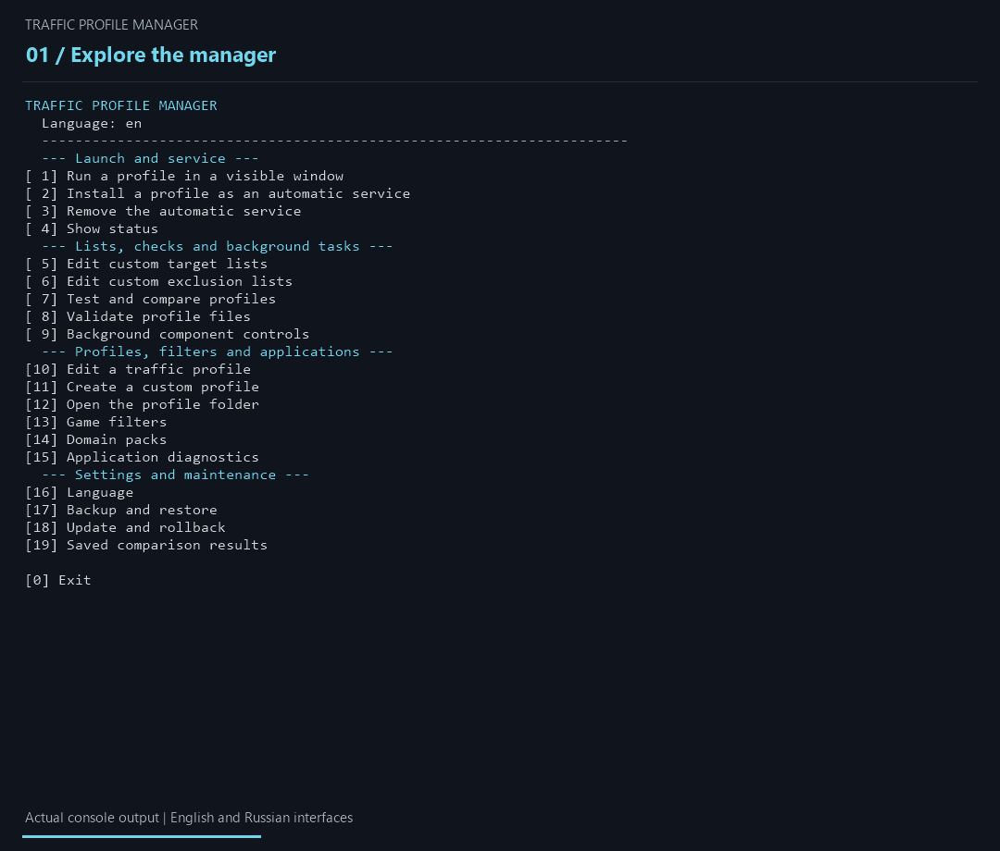

<div align="center">

<h1>Traffic Profile Manager</h1>

<p><strong>Find and configure a zapret2 profile for your connection.</strong></p>

<p>
  
  <a href="https://github.com/ArcheKaren/Traffic-Profile-Manager/releases/latest"></a>
  <a href="https://github.com/ArcheKaren/Traffic-Profile-Manager/actions/workflows/validate.yml"></a>
  
  <a href="LICENSE"></a>
</p>

<p>
  <a href="https://github.com/ArcheKaren/Traffic-Profile-Manager/releases/latest/download/TrafficProfileManager.zip"></a>
</p>

<p>
  <a href="https://github.com/ArcheKaren/Traffic-Profile-Manager/releases/latest">Release notes</a> ·
  <a href="#verify">Verify your download</a>
</p>

<p><a href="../README.md">Русский</a> · <strong>English</strong></p>

</div>

---

Traffic Profile Manager is a portable console manager for zapret2 on Windows:
14 ready-to-use profiles, automated comparison on your connection, game filters
and Windows service controls. No VPN and no telemetry.

Compare profiles against the endpoints you choose, inspect the results and
select a profile. Customize domains, IP ranges and exclusions; run a profile
in a visible window or install it as an automatic service. Results describe
endpoint reachability during that particular run and depend on your connection.

## 🎬 See the workflow



A 25-second walkthrough using actual program output. The comparison is a saved
local run from 28 July 2026, not a prediction for your connection.
[Demo provenance](media/README.md).

## 🚀 Quick start

1. Download `TrafficProfileManager.zip` from the latest release above.
2. Extract the entire `TrafficProfileManager` folder before running anything.
3. Open `Manager.bat` and approve the Windows administrator prompt.
4. Select **Run a profile in a visible window**, then try **Base**.
5. Keep the profile window open. Close it or press `Ctrl+C` to stop the profile
   and clean up its temporary mappings.

Run one profile at a time. Stop the automatic service before using visible mode.
The interface defaults to English; **Manager → Language** switches between
English and Russian and remembers your choice.

## ✨ What you can control

| Task | Where to start |
| --- | --- |
| Compare profiles on your connection | **Test and compare profiles**; reports are saved locally as TXT and CSV |
| Adjust domains, IP/CIDR ranges and exclusions | **Edit custom target lists** and **Edit custom exclusion lists** |
| Create or edit a strategy | **Create a custom profile**, **Edit a traffic profile**, then **Validate profile files** |
| Configure games and domain groups | **Game filters** and **Domain packs** |
| Use an automatic Windows service | **Install a profile as an automatic service** and **Background component controls** |
| Inspect application connectivity | **Application diagnostics** |
| Back up settings or apply an update | **Backup and restore** and **Update and rollback** |

Requires x64 Windows 10/11, Windows PowerShell 5.1 or newer, and system `curl.exe`.
The release ZIP includes the runtime. Source checkouts require the pinned
upstream runtime described in [the build guide](CONTRIBUTING.md#проверки-и-сборка).
The application uses BAT, CMD and PowerShell entry points.

<a id="verify"></a>

## 🔐 Administrator access and download verification

WinDivert intercepts and modifies network packets, so running a profile requires
administrator access. `Manager.bat` requests elevation when opened. Read-only CLI
commands, diagnostics and `winws2 --dry-run` can run without elevation. A service
is installed only when you choose that action; temporary mappings affect the
marked Traffic Profile Manager block in Windows `hosts`.

Download both `TrafficProfileManager.zip` and `SHA256SUMS.txt` from the same
[official release](https://github.com/ArcheKaren/Traffic-Profile-Manager/releases/latest).
In the download folder, run:

```powershell
Get-FileHash -LiteralPath .\TrafficProfileManager.zip -Algorithm SHA256
Get-Content -LiteralPath .\SHA256SUMS.txt
```

The 64-character hashes must match. A checksum confirms file integrity; it does
not by itself prove that software is safe. WinDivert may trigger antivirus
warnings. Inspect the source, provenance and warning details before deciding
whether to run the program.

[Project source](https://github.com/ArcheKaren/Traffic-Profile-Manager) ·
[CI checks and release builds](https://github.com/ArcheKaren/Traffic-Profile-Manager/actions) ·
[Runtime provenance](../runtime/SOURCE.json) ·
[Detailed verification guide in Russian](VERIFY.md)

Reports and logs stay on your computer. The application has no analytics or
telemetry. Network operations include your chosen diagnostic/comparison targets,
DNS resolution for configured temporary mappings and explicit update checks.

## 📚 Documentation and license

The [full Russian manual](../README.md) covers profiles, command-line usage,
service operation and cleanup. See [contributing](CONTRIBUTING.md) and
[security reporting](SECURITY.md) for development and vulnerability reports.

Project code and documentation use the [MIT license](LICENSE). Bundled upstream
components have their own licenses, listed in [third-party notices](THIRD-PARTY-LICENSES.txt).
